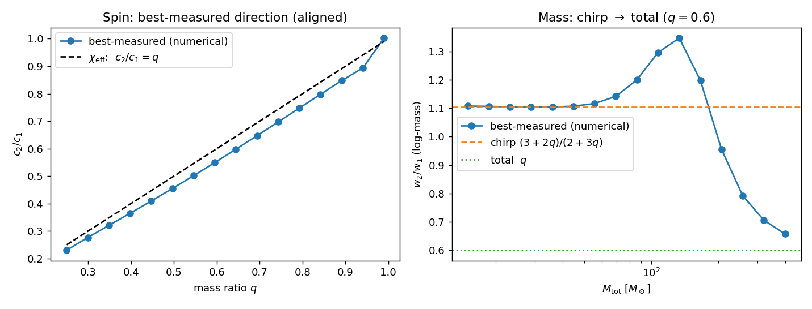
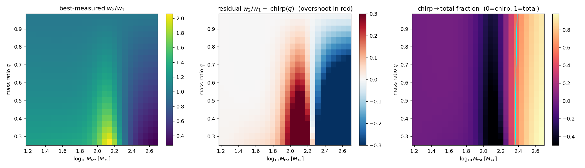
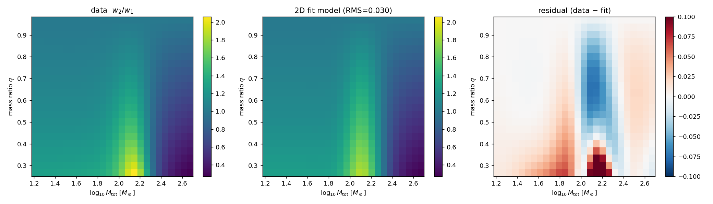
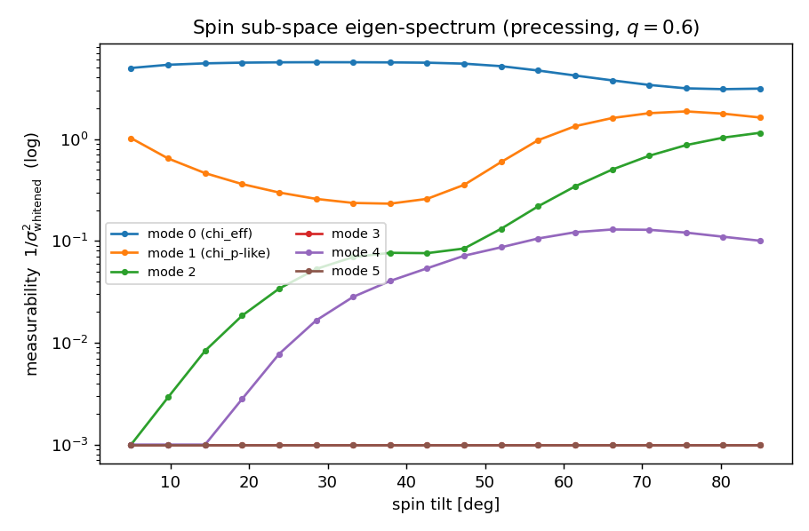
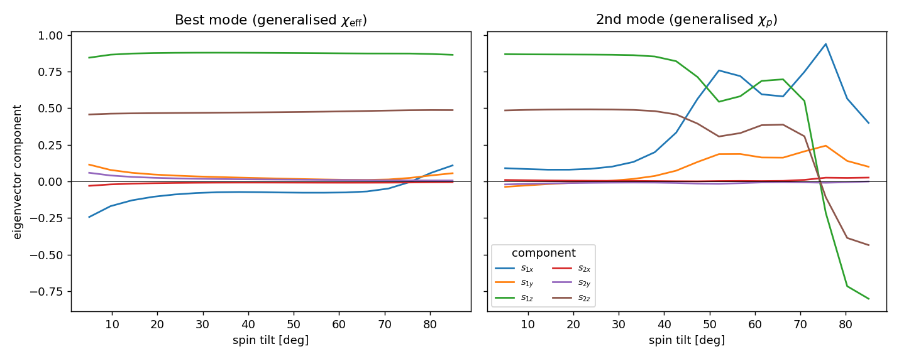

# Best-measured parameter directions: how the code works

These notes explain, in reasonably precise mathematical terms, what the pipeline
actually computes and how. They assume comfort with linear algebra (inverses,
determinants, eigendecomposition, kernels, subspaces, change of basis) but *not*
with gravitational-wave data analysis, so the domain-specific objects (the
Fisher matrix, marginalization, whitening, the Schur complement) are spelled
out. Where a step is a standard linear-algebra fact dressed up in statistics
language, the notes say so.

---

## 1. The object of interest

A gravitational-wave source is described by a parameter vector
$\theta = (\theta_1,\dots,\theta_n)$ — component masses, spins, distance, sky
angles, etc. A detector measures a noisy strain; in the Gaussian/linear-signal
approximation the likelihood of $\theta$ is a Gaussian whose inverse-covariance
("precision") matrix is the **Fisher information matrix** $F(\theta)$.

$F$ is a symmetric positive-semidefinite $n\times n$ matrix. It is the natural
*metric* on parameter space: the squared "distinguishability distance" between
$\theta$ and $\theta + \delta\theta$ is $\delta\theta^\top F\, \delta\theta$.
Equivalently, the covariance of the maximum-likelihood estimate is
$C = F^{-1}$ (the Cramér–Rao bound).

We want, at each $\theta$, the **best-measured combination of parameters** —
the unit direction $\xi$ along which the variance $\xi^\top C\,\xi$ is smallest,
i.e. the direction the data pin down most tightly. As $\theta$ ranges over a
grid we get a *field* of directions $\xi(\theta)$. The physics claim we are
testing is that this field reproduces and generalizes two textbook
combinations: the effective spin $\chi_{\rm eff}$ and the chirp mass.

Three pieces of linear algebra do all the work:

1. **Eigendecomposition** of $F$ (or $C$): the eigenvector with the largest
   eigenvalue of $F$ = smallest eigenvalue of $C$ is the best-measured
   direction. The whole eigenspectrum is the set of principal axes of the
   error ellipsoid $\{\delta\theta : \delta\theta^\top F\,\delta\theta \le 1\}$.
2. **Marginalization** = restricting attention to a sub-block of $C$.
3. **Conditioning** = restricting attention to a sub-block of $F$.
   The interplay between (2) and (3) is a Schur complement (§4).

---

## 2. Software stack

Everything is JAX-based so that derivatives are exact (automatic
differentiation), not finite differences — clean derivatives are what make the
eigenvector field smooth enough to fit.

| package | role |
|---|---|
| `jax` / `jaxlib` (0.9.0, CUDA) | autodiff + GPU linear algebra |
| `gwfast` | aligned-spin waveforms + its own `FisherMatr`, `CovMatr`, `fixParams` |
| `ripplegw` (import `ripplegw`) | JAX waveforms incl. **precessing** `IMRPhenomPv2/XP/XPHM` |
| `jimgw` | Bayesian sampler/likelihood (installed; not yet used here) |
| `numpy`/`scipy` | host-side eigensolvers, curve fitting |

Our own package is `omp/`. The key modules:

- `omp/fisher.py` — `FisherWorkspace`: thin wrapper that calls **gwfast's**
  `FisherMatr` (aligned spin).
- `omp/ripple_fisher.py` — `RippleFisherWorkspace`: builds the Fisher matrix
  *ourselves* from ripple waveforms (gwfast's `FisherMatr` cannot consume ripple
  waveforms). This is where precession enters.
- `omp/eigen.py` — all the linear algebra: sub-space reductions, whitening,
  eigendecomposition, continuity tracking.
- `omp/params.py` — coordinate bookkeeping and Jacobians.

---

## 3. Building the Fisher matrix

For a single detector with noise power spectral density $S_n(f)$, the Fisher
matrix is a Gram matrix of waveform derivatives under a frequency-domain inner
product:

$$
F_{ij} \;=\; (\partial_i h \,|\, \partial_j h), \qquad
(a|b) \;=\; 4\,\mathrm{Re}\!\int_{f_{\min}}^{f_{\max}} \frac{a(f)^*\,b(f)}{S_n(f)}\, df .
$$

Read $(\cdot|\cdot)$ as a (noise-weighted, frequency-domain) inner product; then
$F$ is literally the Gram matrix of the vectors $\partial_i h$. Positive
semidefiniteness is automatic (a Gram matrix), and the kernel of $F$ is exactly
the span of parameter directions the waveform does not depend on (to first
order) — a fact we lean on in §5.

**Two backends.**

- *gwfast* computes this internally (its `FisherMatr`) for aligned-spin
  waveforms and sums over a detector network.
- *ripple* only gives us $h(f)$, so `ripple_fisher.py` forms $F$ directly. The
  derivative tensor $\partial_i h(f)$ is obtained with `jax.jacfwd` (forward-mode
  AD — efficient here because the output dimension, the frequency grid, is much
  larger than the input dimension, the parameters). The integral is a trapezoid
  sum; the PSD is interpolated onto the frequency grid and the integrand is
  masked to zero outside the band where the PSD is defined. The whole
  per-event computation is `jax.vmap`-ed over the parameter grid and JIT-compiled,
  so a grid of sources is one batched GPU call.

A non-obvious but important detail: ripple's strain is *complex*, the parameters
are *real*, so `jacfwd` returns a complex Jacobian; the inner product takes the
real part of $\partial_i h^* \,\partial_j h$, recovering a real symmetric $F$.

---

## 4. Coordinates and Jacobians

The eigenvectors are basis-dependent, so the choice of parameters matters.

- **Masses.** We want the mass sub-space in $(\log m_1, \log m_2)$ because the
  textbook combinations are *ratios* of masses (multiplicative structure →
  additive in logs). With ripple we simply *write* the waveform call as a
  function of $(\log m_1, \log m_2)$ and let AD propagate the chain rule through
  the intermediate $(\mathcal{M}_c, \eta)$ that the waveform actually uses. No
  explicit Jacobian — the change of variables is absorbed by differentiating the
  composition. (gwfast needs the Jacobian applied by hand:
  $F_{\log} = \mathrm{diag}(m)\,F\,\mathrm{diag}(m)$.)

- **Spins.** Aligned spin is two numbers $(\chi_{1z},\chi_{2z})$. Precessing spin
  is the full Cartesian pair of 3-vectors $(s_{1x},s_{1y},s_{1z},s_{2x},s_{2y},s_{2z})$
  at a reference frequency. We parameterize physically as magnitude/tilt/azimuth
  $(a_i,\,\mathrm{tilt}_i,\,\phi_i)$ and convert to Cartesian
  ($s_z = a\cos\mathrm{tilt}$, etc.) in `SourceParams.from_spherical`. We
  differentiate in Cartesian components because $\chi_{\rm eff}$ (a combination
  of the $z$-components) and $\chi_p$ (a combination of the in-plane components)
  are *linear* there — so they can show up directly as eigenvectors.

---

## 5. Reducing to a sub-space: marginalization, conditioning, Schur complements

We rarely want the eigenvectors of the full $n\times n$ problem; we want the
best-measured *spin* combination or *mass* combination, having accounted for our
ignorance of everything else. Split the parameters into the sub-space of
interest $s$ and the nuisances $n$, and block the Fisher matrix:

$$
F \;=\; \begin{pmatrix} F_{ss} & F_{sn} \\ F_{ns} & F_{nn} \end{pmatrix}.
$$

There are two inequivalent ways to "ignore" $n$:

**Conditioning** (assume $n$ known exactly): just take the sub-block $F_{ss}$.
Its inverse is the conditional covariance. In code: `condition`
(via gwfast's `fixParams`). This *overstates* how well we measure $s$, because
it pretends the nuisances are pinned.

**Marginalization** (integrate $n$ out, the honest thing): the covariance of $s$
is the corresponding sub-block of the *full inverse*, $\big(F^{-1}\big)_{ss}$.
By the block-inverse identity this equals

$$
\big(F^{-1}\big)_{ss} \;=\; \big(\underbrace{F_{ss} - F_{sn} F_{nn}^{-1} F_{ns}}_{\textstyle \bar F_{ss}}\big)^{-1}.
$$

The matrix $\bar F_{ss} = F_{ss} - F_{sn}F_{nn}^{-1}F_{ns}$ is the **Schur
complement** of the nuisance block $F_{nn}$ in $F$. A few ways to see what it
is, all standard:

- *Completing the square / Gaussian integral.* Writing the log-likelihood
  quadratic form $\theta^\top F\theta$ and minimizing over $n$ at fixed $s$
  (equivalently, integrating the Gaussian over $n$) leaves a quadratic form in
  $s$ with matrix exactly $\bar F_{ss}$. So the Schur complement *is* the
  effective Fisher for $s$ after optimally absorbing the nuisances.
- *Determinants.* $\det F = \det F_{nn}\,\det \bar F_{ss}$ — the Schur complement
  is the factor that makes block-triangular elimination work (it is the bottom
  block left after Gaussian elimination of $n$).
- *Projection.* $F_{sn}F_{nn}^{-1}F_{ns}$ is the part of the $s$–$s$ curvature
  that can be "explained away" by adjusting the nuisances; subtracting it leaves
  the curvature genuinely intrinsic to $s$.

The point of using the Schur complement explicitly (`marginalized_subfisher_schur`
in `eigen.py`) rather than forming the full $F^{-1}$ and slicing it
(`marginalize`, via gwfast's `CovMatr`) is **numerical**, and §7 explains why it
is not optional once precession is involved.

---

## 6. Whitening and the eigenproblem

The eigenvectors of $C$ (or $F$) are *not* invariant under rescaling the
parameters — and our parameters have wildly different units (a solar mass vs. a
dimensionless spin). "The direction of smallest variance" is meaningless until
we fix a metric on parameter space. We fix it by **whitening**: rescale each
parameter by its own one-sigma so the problem becomes dimensionless.

Concretely, with $D = \mathrm{diag}(\sigma_1,\dots,\sigma_k)$,

$$
C_{\rm w} = D^{-1} C\, D^{-1} \quad(\text{a correlation matrix, unit diagonal}),
$$

and we eigendecompose $C_{\rm w}$. The smallest-eigenvalue eigenvector $b$ is the
best-measured *whitened* direction; the physical coefficients are
$a = D^{-1} b$ (un-rescaling), normalized. This is a deliberate, documented
choice of basis — not a canonical operation — and the whole point is that it
makes "best measured" comparable across heterogeneous parameters.

Best-measured direction = **smallest** eigenvalue of $C_{\rm w}$ = **largest**
eigenvalue of the whitened Fisher. Since $C = F^{-1}$, these are the same
eigenvectors with reciprocal eigenvalues; which matrix we actually diagonalize is
a numerical decision (§7).

`eigen.py` implements both: `eigen_from_cov` (smallest eigenvalue of a whitened
covariance) and `eigen_from_fisher` (largest eigenvalue of a whitened Fisher).

---

## 7. Why precession forced a change of recipe

For the aligned 2-D spin problem all routes agree exactly: marginalize-then-
invert, Schur, and Fisher-side eigendecomposition give the same
$c_2/c_1 = 0.5538$ at $q=0.6$. The trouble appears in the full 6-D precessing
spin space.

There, the in-plane spin components (which carry $\chi_p$) are measured
$10^3$–$10^6$ times *worse* than the aligned components (which carry
$\chi_{\rm eff}$). In linear-algebra terms, the Fisher matrix has an approximate
**kernel**: a large subspace of directions along which the waveform barely
changes. The full $F$ then spans ~20 orders of magnitude in eigenvalue
(condition number $\sim 10^{20}$), which is at the edge of double precision.

Forming $C = F^{-1}$ and slicing it amplifies the floating-point noise in those
near-null directions into the dominant entries of $C$. The resulting "covariance"
is no longer positive-definite — its whitened eigenvalues come out as
`[-4, 0, 0, 0, 0.004, 2]`: negative and zero "variances," which are
mathematically impossible for a true covariance and signal pure numerical
breakdown. The best-measured eigenvector extracted that way was garbage (it
reported $\chi_{\rm eff}$ as a *difference* of spins instead of the sum).

The fix is to never invert the ill-conditioned form. We keep the object we have
cleanly — the Fisher, and specifically its marginalized version $\bar F_{ss}$
(the Schur complement, which only requires inverting the *well*-conditioned
nuisance block $F_{nn}$) — and take its **largest-eigenvalue** eigenvectors
directly, whitening by the Fisher diagonal $1/\sqrt{\bar F_{ii}}$ (always
well-defined, since the diagonal of a real Fisher is strictly positive). This is
`method="marginalize_fisher"`. The unmeasured directions simply come out with
near-zero Fisher eigenvalue → formally infinite variance, which we report as
such instead of letting them poison the inversion. On well-conditioned problems
it is provably identical to the covariance recipe; on sloppy ones it is the only
one that survives.

(This is the classic "sloppy model" situation: the eigenspectrum of the
information metric spans many decades, a few *stiff* directions are well
constrained and many *sloppy* ones are nearly flat. The right move is always to
work with the metric, not its inverse.)

---

## 8. Tracking the field smoothly across the grid

At each grid point eigendecomposition returns eigenvectors in an arbitrary order
and with arbitrary signs (an eigenvector is only defined up to $\pm1$, and
eigenvalues can cross). To make $\xi(\theta)$ a smooth field we solve a small
**assignment problem** between adjacent grid points: match each eigenvector to
the previous point's eigenvector of maximum overlap, then fix the sign for
positive overlap (`enforce_continuity`).

A subtlety worth flagging: we match on the *whitened, orthonormal* eigenvectors,
not the physical (non-orthonormal) coefficient vectors. Orthonormal vectors have
an overlap matrix that is close to a signed permutation, so the greedy
max-overlap assignment is unambiguous; using the non-orthonormal physical
vectors caused mis-assignments near level crossings (best and worst modes
swapping). This is just the observation that the permutation is cleanest in an
orthonormal basis.

---

## 9. What the field looks like

### Aligned spin and mass (the known limits)

*Left:* the best-measured spin direction's weight ratio $c_2/c_1$ vs mass ratio
$q$, against the $\chi_{\rm eff}$ prediction $c_2/c_1 = q$. The numerical field
sits slightly below $\chi_{\rm eff}$ — a genuine, smooth generalization.
*Right:* the best-measured log-mass weight ratio vs total mass at fixed $q$,
interpolating from the chirp-mass value $(3+2q)/(2+3q)$ at low mass toward the
total-mass value $q$ at high mass.

### Mass: the joint $(M_{\rm tot}, q)$ structure

The best-measured log-mass weight ratio over the whole $(M_{\rm tot}, q)$ plane
(`scripts/mass_grid2d.py`). Three regimes are visible: a **chirp plateau** at low
total mass, an **overshoot ridge** at $M_{\rm tot}\sim100$–$140\,M_\odot$ where
the ratio rises *above* the chirp value (middle panel, red), and a drop to the
**total-mass** value at high mass. Two clean structural facts fall out:

- The chirp$\to$total crossover (cyan 0.5 contour, right panel) is at
  $M_{\rm tot}\approx200$–$250\,M_\odot$ and **nearly independent of $q$** — it is
  set by where merger/ringdown enters the detector band, a function of total mass
  alone.
- The overshoot is a **coherent ridge, strongest at small $q$** (unequal masses),
  vanishing as $q\to1$ (where chirp $\approx$ total and there is nothing to
  transition between — also the near-degenerate regime needing the SVD fallback).

This is why the naive monotonic chirp$\to$total sigmoid fit poorly: the surface is
a monotonic, $q$-independent transition *plus* a separable overshoot bump
localized in $\log M_{\rm tot}$ and modulated by $(1-q)$.

**The 2-D closed-form fit** (`omp.fit.fit_mass_2d`) encodes exactly that:

$$
\frac{w_2}{w_1} = (1-s)\,\frac{3+2q}{2+3q} + s\,q
\;+\; A\,(1-q)\,e^{-\frac{1}{2}\left(\frac{x-\mu}{w}\right)^2},
\qquad x=\log_{10}M_{\rm tot},\ \ s=\mathrm{sigmoid}\!\big(k(x-\log_{10}M_\star)\big),
$$

with fitted values $M_\star\approx216\,M_\odot$ (transition, $k\approx9.4$) and an
overshoot bump of amplitude $A\approx0.94$ at $M_{\rm tot}\approx135\,M_\odot$,
width $\approx0.12$ in $\log_{10}M_{\rm tot}$. This reaches **RMS $\approx0.030$**,
versus $\approx0.12$ for the bump-less sigmoid on the same grid — a 4$\times$
improvement, and the form is interpretable: a $q$-independent transition mass plus
a $(1-q)$-scaled overshoot.

Data, fitted model, and residual. The residual is small everywhere except a
localized excess at the low-$q$ tip of the overshoot ridge, where the true bump is
slightly asymmetric (rises gently, falls sharply into the transition) rather than
the symmetric Gaussian assumed here — the obvious next refinement (skewed bump or
a stronger-than-linear $q$ dependence).

### Precessing spin: the measurability spectrum

The six eigen-measurabilities ($1/\sigma^2$ in whitened units, log scale) of the
spin sub-space as the spin tilt is increased. One mode ($\chi_{\rm eff}$) is
always well measured; a second ($\chi_p$-like) climbs out of the noise as the
tilt — and hence the physical precession — grows; the remaining four stay
near-flat (the approximate kernel of §7). This is the sloppy spectrum that makes
the covariance inversion fail and the Fisher-side recipe necessary.

### Precessing spin: the eigenvector field

The components of the best mode (left) and second mode (right) as the tilt
varies. The best mode stays dominated by the aligned components $s_{1z},s_{2z}$
(it *is* the generalized $\chi_{\rm eff}$, essentially tilt-independent), while
the second mode carries the in-plane components — the generalized $\chi_p$ — with
a weight that grows as precession turns on. This is exactly the structure we
want to fit.

---

## 10. Numerical pitfalls (collected)

- **Branch points.** ripple's precession angles are non-differentiable at
  *exactly* zero in-plane spin, and $\sqrt{1-4\eta}$ is non-differentiable at
  *exactly* equal mass ($q=1$). `jacfwd` returns `nan` there. Sample a tiny tilt
  / $q=0.999$ instead.
- **Conditioning.** The full precessing Fisher has condition number $\sim10^{20}$;
  see §7. Use `marginalize_fisher`.
- **PSD support.** The noise curve is only defined on a finite band; the
  integrand is masked to zero outside it (treating out-of-band as infinitely
  noisy) rather than extrapolating.

---

## 11. Future directions

**Closed-form fits (the main deliverable).** We already have a clean polynomial
fit for the aligned $\chi_{\rm eff}$ generalization and a (poorer) sigmoid for
the chirp→total mass transition. The precessing field needs:

- A functional form for the **second (\chi_p-like) mode** as a function of
  $(q,\,\mathrm{tilt},\,M_{\rm tot})$, generalizing the standard
  $\chi_p = \max\!\big(a_1\sin t_1,\ \tfrac{3+4q}{4+3q}\,q\,a_2\sin t_2\big)$.
  The numerical field should reveal whether the true best-measured in-plane
  combination is the `max` form or something smoother.
- **Symbolic regression** (e.g. `PySR`/SymbolicRegression.jl) to *discover* the
  functional form rather than assume it. The eigenvector components vs
  $(q,\mathrm{tilt},M_{\rm tot})$ are exactly the kind of low-dimensional,
  smooth, noiseless targets symbolic regression handles well — and because the
  inputs $\chi_{\rm eff}$ and $\chi_p$ are themselves simple rationals in the
  spins and $q$, there is a good chance of recovering interpretable closed forms.
  Worth seeding the operator set with the building blocks ($q$, $\sin/\cos$ tilt,
  $m_1/m_2$) and penalizing complexity hard.

**Integrability — is the field a gradient?** A best-measured *direction* field
$\xi(\theta)$ defines a genuine *parameter* (a scalar generalized
$\chi_{\rm eff}$) only if it is integrable, i.e. proportional to $\nabla\Phi$ for
some $\Phi$. In 2-D sub-spaces this is automatic (any direction field foliates);
in $\ge 3$-D it is a real condition (a curl/Frobenius test on $\xi$). Testing
integrability of the 6-D spin field tells us whether a single closed-form
combination can exist globally or only patch-wise — and where it breaks is
physically the same place the "effective parameter" stops being conserved.

**Coverage.** Extend from the single-detector / single-slice demos to full
$(q,\mathrm{tilt},\phi,M_{\rm tot},z)$ grids and several detector networks
(HLV, ET+CE), and compare the field across networks (the best-measured direction
should be fairly network-independent if it is truly intrinsic).

**Source-frame masses + redshift.** Currently the Fisher is taken in
detector-frame masses. Differentiating in source-frame $(m_1,q,z)$ needs the
redshift Jacobian; the strong mass–redshift degeneracy means $z$ is effectively
fixed by the distance/cosmology and should be marginalized, not conditioned.
